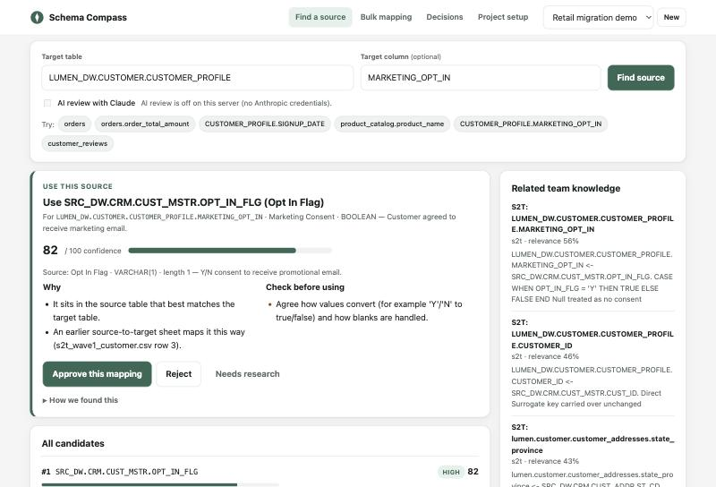
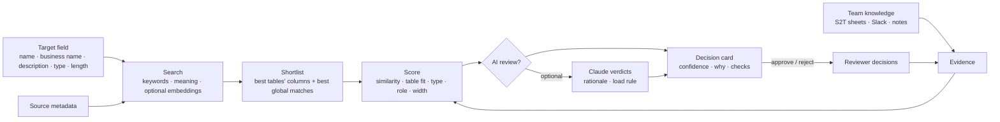

# Schema Compass

**Find the right source table and column for every field of a target data product, with a confidence score, a plain-language recommendation, and the evidence behind it.**

When teams migrate or consolidate data in Snowflake or Databricks, analysts spend days searching the source system for the column that feeds each target field. Names rarely line up (`CRT_DT` vs `signup_date`), and the real answer often sits in an old mapping spreadsheet or a Slack thread. Schema Compass automates that search. You enter a target table and column. It reads the target's definition, searches the source metadata by meaning and keywords, checks your team's documents, and tells you which source to use, how sure it is, and what to verify first.



- **Self-service web app.** Upload metadata in the browser; you don't write code or edit config files.
- **Explainable.** Every answer comes with a confidence score, why the source was chosen, what to check before using it, and how it was found.
- **Uses team knowledge.** It reads earlier source-to-target (S2T) sheets, Slack exports and notes, which confirm or warn against candidates.
- **Learns from reviewers.** Approved mappings rank first in later searches; rejected ones are suppressed.
- **Optional AI review.** Claude double-checks the shortlist and suggests a load rule.
- **Metadata only.** Schema Compass never reads your actual data rows.

## Contents

- [Get started in five minutes](#get-started-in-five-minutes)
- [Sample datasets](#sample-datasets)
- [Use it on your own migration](#use-it-on-your-own-migration)
- [Optional features](#optional-features)
- [Where your data goes](#where-your-data-goes)
- [Deploy for a team](#deploy-for-a-team)
- [How matching works](#how-matching-works)
- [Command line and API](#command-line-and-api)
- [Troubleshooting](#troubleshooting)
- [Development](#development)

## Get started in five minutes

### Option A: Python

Requires Python 3.11 or later and Git. Check your Python version first:

```bash
python3 --version        # Windows: py --version
```

If it shows a version below 3.11, install a newer one first. On macOS, Apple's built-in Python is 3.9, so run `brew install python@3.12` or use the installer from [python.org](https://www.python.org/downloads/). Then open a new terminal.

macOS and Linux:

```bash
git clone https://github.com/sidbhaumik/schema-compass-ai.git
cd schema-compass-ai
python3 -m venv .venv
source .venv/bin/activate
pip install -r requirements.txt
python -m schema_compass.cli serve
```

Windows (PowerShell):

```powershell
git clone https://github.com/sidbhaumik/schema-compass-ai.git
cd schema-compass-ai
py -m venv .venv
.venv\Scripts\Activate.ps1
pip install -r requirements.txt
python -m schema_compass.cli serve
```

Once the virtual environment is active (your prompt shows `(.venv)`), `python` and `pip` refer to its Python, so the last two commands work on every platform. Open **http://127.0.0.1:8000**. Stop the server with `Ctrl+C`. Next time, run `cd schema-compass-ai`, then activate the environment and start the server again (the first two commands after `git clone` aren't needed).

### Option B: Docker

Requires [Docker Desktop](https://www.docker.com/products/docker-desktop/) or another Docker engine. You don't need to clone anything: the prebuilt image runs on Intel/AMD and Apple Silicon.

```bash
docker run -d --name schema-compass -p 8000:8000 -v compass-data:/data ghcr.io/sidbhaumik/schema-compass-ai:1.0.0
```

Open **http://localhost:8000**. Projects are stored in the `compass-data` volume and survive restarts and upgrades. Stop the container with `docker stop schema-compass`. To enable AI review, add `-e ANTHROPIC_API_KEY=sk-ant-...`. To upgrade, remove the container and run the same command with the new version, keeping the volume.

To build the image from source instead, clone the repo and run `docker build -t schema-compass .`.

### Try the samples

On first start the app creates the **Retail acquisition** sample project. It's a fictional acquisition: the target organization (Databricks and Snowflake tables such as `lumen.sales.orders`) is backfilling ten years of history from a source Snowflake warehouse with terse names such as `ORD_HDR.TOT_AMT`. Click the suggested searches under the search box, or try these:

| Target table / column | What you'll see |
| --- | --- |
| `orders` | **Use** `ORD_HDR`. The look-alike `ORD_HDR_LGCY` is demoted because a Slack thread says it's deprecated. |
| `orders` / `customer_id` | `ORD_HDR.CUST_ID`, not `CUST_MSTR.CUST_ID`. The parent table's context breaks the tie between identical names. |
| `CUSTOMER_PROFILE` / `SIGNUP_DATE` | `CRT_DT`. The names barely match, but an earlier S2T sheet maps it. |
| `product_catalog` / `product_name` | `ITEM_DESC`, not `SKU_ID` (an identifier, not a name) and not `ITEM_LONG_DESC` (Slack says it holds marketing copy). |
| `CUSTOMER_PROFILE` / `MARKETING_OPT_IN` | Use `OPT_IN_FLG`, but first agree how `'Y'`/`'N'` converts to a boolean. |
| `customer_reviews` | **No reliable source found.** The documents say this data never existed in the source. |

## Sample datasets

Four fictional scenarios ship with the app, each built to show different features. Select **New** in the top bar, then **Create** next to a sample to get a ready-to-use project with its suggested searches. Or select **Download files** and upload them yourself to practice the setup flow.

| Sample | Source → target | What it exercises | Try |
| --- | --- | --- | --- |
| [Retail acquisition](samples/retail-acquisition/) | Snowflake (abbreviated names) → Databricks + Snowflake | Deprecated look-alike table, S2T and Slack evidence, Y/N to boolean, a table with no source | `product_catalog` / `product_name` |
| [SaaS product analytics](samples/saas-product-analytics/) | Snowflake (camelCase tracker tables) → Databricks | camelCase names, VARIANT to JSON, timestamp to date, time zone notes, fields with no source | `experiment_exposures` / `experiment_key` |
| [Clinic network EHR](samples/clinic-network/) | Databricks (clinical codes) → Snowflake | Clinical abbreviations (PT, DX, RSLT), an Excel S2T sheet, text-to-date and text-to-number cautions, a calculated field | `LAB_RESULT` / `RESULT_VALUE` |
| [People analytics (HR)](samples/people-analytics/) | Snowflake HRIS, delivered as Excel with its own headers → Databricks | Non-standard Excel headers, close look-alikes (original vs last hire date, legal vs preferred name), percent to fraction | `employees` / `hire_date` |

Each sample folder has a README, an answer key (`gold_mappings.csv`) and a ready-made list for bulk mapping (`bulk_fields.csv`). All sample data is fictional metadata; none of it is real data. To add your own sample, see [`samples/README.md`](samples/README.md).

## Use it on your own migration

### 1. Create a project

Select **New** in the top bar and name the project, for example "Warehouse consolidation wave 2". A project holds one source metadata set, one target metadata set, reference documents and reviewer decisions. Create one project per migration or wave.

### 2. Export metadata from each platform

You need two files, one for the **source** (where data comes from) and one for the **target** (the data products you're building). Each has one row per column. You can export straight from the platform's information schema with the queries below, then download the results as CSV from Snowsight or the Databricks SQL editor.

<details>
<summary><b>Snowflake</b>: replace <code>MY_DB</code></summary>

```sql
SELECT 'SNOWFLAKE'                                                   AS PLATFORM,
       c.TABLE_CATALOG || '.' || c.TABLE_SCHEMA || '.' || c.TABLE_NAME AS TABLE_PHYSICAL_NAME,
       NULL                                                          AS TABLE_LOGICAL_NAME,
       t.COMMENT                                                     AS TABLE_DESCRIPTION,
       c.COLUMN_NAME                                                 AS COLUMN_PHYSICAL_NAME,
       NULL                                                          AS COLUMN_LOGICAL_NAME,
       c.COMMENT                                                     AS COLUMN_DESCRIPTION,
       c.DATA_TYPE                                                   AS COLUMN_DATATYPE,
       c.CHARACTER_MAXIMUM_LENGTH                                    AS COLUMN_LENGTH
FROM MY_DB.INFORMATION_SCHEMA.COLUMNS c
JOIN MY_DB.INFORMATION_SCHEMA.TABLES t
  ON t.TABLE_SCHEMA = c.TABLE_SCHEMA AND t.TABLE_NAME = c.TABLE_NAME
WHERE c.TABLE_SCHEMA <> 'INFORMATION_SCHEMA'
ORDER BY 2, c.ORDINAL_POSITION;
```
</details>

<details>
<summary><b>Databricks (Unity Catalog)</b>: replace <code>my_catalog</code></summary>

```sql
SELECT 'DATABRICKS'                                                    AS PLATFORM,
       concat_ws('.', c.table_catalog, c.table_schema, c.table_name)   AS TABLE_PHYSICAL_NAME,
       NULL                                                            AS TABLE_LOGICAL_NAME,
       t.comment                                                       AS TABLE_DESCRIPTION,
       c.column_name                                                   AS COLUMN_PHYSICAL_NAME,
       NULL                                                            AS COLUMN_LOGICAL_NAME,
       c.comment                                                       AS COLUMN_DESCRIPTION,
       c.full_data_type                                                AS COLUMN_DATATYPE,
       c.character_maximum_length                                      AS COLUMN_LENGTH
FROM my_catalog.information_schema.columns c
JOIN my_catalog.information_schema.tables t
  ON t.table_schema = c.table_schema AND t.table_name = c.table_name
WHERE c.table_schema <> 'information_schema'
ORDER BY 2, c.ordinal_position;
```
</details>

If your target spans both platforms, export each one and combine the rows into one file. The `PLATFORM` column keeps them apart.

**Fill in business names and descriptions where you can.** Information schemas often lack them, but your data dictionary or catalog tags usually have them. They are the strongest matching signals: a column with a good description can be matched even when its name is cryptic.

You don't have to use those exact headers. Common spellings are recognized automatically:

| Field | Required | Recognized headers (examples) |
| --- | --- | --- |
| Table name | Yes | `table_name`, `table_physical_name`, `table`; separate `database`/`catalog` and `schema` columns are joined automatically |
| Column name | Yes | `column_name`, `column_physical_name`, `field_name` |
| Table business name / description | Recommended | `table_logical_name`, `data_product` · `table_description`, `table_comment` |
| Column business name | Recommended | `column_logical_name`, `business_name`, `attribute_name`, `business_term` |
| Column description | Recommended | `column_description`, `description`, `definition`, `comment` |
| Data type / length | Recommended | `data_type`, `datatype`, `full_data_type` · `length`, `character_maximum_length` |
| Platform | Optional | `platform` (`SNOWFLAKE` or `DATABRICKS`); otherwise the platform you pick at upload |

For example files, see [`samples/retail-acquisition/source_metadata.csv`](samples/retail-acquisition/source_metadata.csv), or the [People analytics workbook](samples/people-analytics/source_metadata.xlsx), which uses HRIS-style headers (`Table Name`, `Field Name`, `Definition`, `Data Type`).

### 3. Upload the metadata

In **Project setup**, drop the source file on card 1 and the target file on card 2 (CSV or Excel, up to 25 MB each). Pick the default platform first if your file has no `PLATFORM` column. Each upload shows a quality report: the number of tables and columns, and what percentage have descriptions, business names and data types. It also gives tips, such as "Only 30% of columns have a description." To update a file later, upload it again. Changes apply immediately.

### 4. Add reference documents (optional, recommended)

Drop files on card 3. They are searched whenever you look up a field, and they can raise or lower a candidate's score.

| Document | Format | What it should contain |
| --- | --- | --- |
| Earlier S2T mapping sheets | `.csv`, `.xlsx` | Columns like `target_table, target_column, source_table, source_column`, plus optional `transformation` and `notes`. Common aliases are accepted. |
| Slack conversations | `.json` | A channel export: a list of messages, or `{"channel": ..., "messages": [...]}`. Replies are grouped by thread. |
| Notes, data dictionaries, runbooks | `.md`, `.txt` | Any text. It's split by heading. |

Each [sample](samples/) has examples in its `knowledge/` folder. A passage counts as evidence for a candidate only when it names both the target field and the source field. Each sentence is read separately. "Use X" counts only in a sentence that names the target. "Not X" or "instead of X" in such a sentence turns it into a warning. "X is deprecated" or "don't use X" warns wherever it appears. Notes like "heads up" or "time zone" become checks rather than votes. Phrases like "nothing to backfill", "no source" or "never stored" mark a target as having no source. If the passage names specific columns, the warning covers only those.

### 5. Find a source

On **Find a source**, start typing a target table (physical or business name), optionally choose a column, and select **Find source**. Leave the column blank to find the best source *table*. The decision card shows:

| Part of the card | Meaning |
| --- | --- |
| **Decision** | **Use this source** (80+, clear lead): confirm quickly and use. **Likely source, confirm before using** (60–79). **Possible source, needs research** (40–59). **No reliable source found** (under 40): probably a new, derived or out-of-scope field. |
| **Confidence** | 0–100. It combines name, description and meaning similarity, the parent table's fit, data type and field role checks, and evidence from your documents and past decisions. |
| **Why** | Plain-language reasons, such as "An earlier source-to-target sheet maps it this way." |
| **Check before using** | Concrete risks: values wider than the target, `'Y'/'N'` to boolean conversions, time zones, close runner-ups, warnings from documents. |
| **How we found this** | Each step the engine took and what it searched. |
| **All candidates** | The other options, ranked, with details and evidence. You can approve one of these instead. |
| **Related team knowledge** | The most relevant passages from your documents. |

### 6. Record the decision

Choose **Approve this mapping**, **Reject**, or **Needs research**, and optionally add a note. Approvals pin the mapping near 100 in later searches, and rejections push it down. The **Decisions** page lists every decision and lets you download approved mappings as an S2T sheet. You can upload that sheet into the next project as a reference document.

### 7. Map many fields at once

On **Bulk mapping**:
- **Map a whole table**: pick a target table to get a recommendation for every column.
- **Upload a list of fields**: a CSV or Excel file with `target_table` and optional `target_column` columns (a template link is on the page). A blank column maps every column of that table. The limit is 5,000 columns per upload.

Both produce a table you can review on screen and a **spreadsheet download**. Each row has the recommended source, confidence, decision, reasons, checks, evidence and two alternatives. Select **Open** on any row to see its full decision card.

## Optional features

### AI review with Claude

Claude reads the target definition, the top five candidates and the related document passages. For each candidate it returns a verdict, a confidence score and a one-line rationale, and for the best one a suggested load rule such as `CASE WHEN OPT_IN_FLG = 'Y' THEN TRUE ELSE FALSE END`. Its confidence is blended (60%) with the built-in score. Without it, everything else works the same.

1. Get an API key from the [Claude Console](https://platform.claude.com/).
2. Start the server with the key set:

   ```bash
   export ANTHROPIC_API_KEY=sk-ant-...        # Windows PowerShell: $env:ANTHROPIC_API_KEY="sk-ant-..."
   python -m schema_compass.cli serve
   # or: docker run ... -e ANTHROPIC_API_KEY=sk-ant-... schema-compass
   ```
3. Tick **AI review with Claude** under the search box. In bulk mapping, AI review is limited to 50 fields per upload to keep costs predictable.

The default model is `claude-opus-5-5` at `medium` effort. Override them with `SCHEMA_COMPASS_MODEL` and `SCHEMA_COMPASS_EFFORT`. If the API can't be reached, you get the standard ranking and a note in **How we found this**.

### Meaning-based embeddings

Embeddings add a dense semantic similarity signal on top of keyword matching. They help most when names and descriptions use different vocabulary. The model runs locally and its vectors are cached.

```bash
pip install -r requirements-semantic.txt
SCHEMA_COMPASS_EMBEDDINGS=sentence-transformers/all-MiniLM-L6-v2 python -m schema_compass.cli serve
```

The first start downloads the model, about 90 MB.

## Where your data goes

- **Stays on your server:** uploaded metadata, documents, decisions and exports. They live in the project folder: `./workspace` by default, `/data` in Docker, or wherever `SCHEMA_COMPASS_HOME` or `--home` points. Back up that folder to keep your projects.
- **Never touched:** actual data rows. Schema Compass works only on metadata.
- **Sent to Anthropic only when AI review is ticked:** the target field's metadata, the top candidates' metadata, and the related document snippets. Don't enable AI review if your policies don't allow that.
- **Deleting a project** only hides it. Its files stay in place, and removing `deleted_at` from its `project.json` restores it.

## Deploy for a team

The server has **no built-in login**. Run it on your own machine, or put it behind something that handles sign-in. If your proxy forwards the signed-in user (`X-Forwarded-Email`), decisions are recorded under that user automatically.

| Option | Steps |
| --- | --- |
| **Docker** | Run `ghcr.io/sidbhaumik/schema-compass-ai:<version>` as in [Option B](#option-b-docker) on a server behind your SSO proxy. Mount a persistent volume at `/data`. |
| **Databricks Apps** | See [Deploy on Databricks Apps](#deploy-on-databricks-apps) below. Databricks handles sign-in, each decision records the user's email, and projects persist on a Unity Catalog volume. |
| **Any VM** | `python -m schema_compass.cli serve --host 0.0.0.0 --home /srv/schema-compass`, behind a reverse proxy with SSO. |

### Deploy on Databricks Apps

Requires Databricks CLI v1.0 or later, signed in with `databricks auth login --profile <profile>`. Add `--profile <profile>` to each command below.

1. **Create storage for projects.** App disks are wiped on every restart, so projects live on a Unity Catalog volume.
   ```bash
   databricks schemas create schema_compass <catalog>
   databricks volumes create <catalog> schema_compass app_data MANAGED
   ```
2. **Create the app** with read and write access to that volume. The resource key `data-volume` is what [`app.yaml`](app.yaml) expects. Run it on one instance, because the app keeps a local working copy of the volume.
   ```bash
   databricks apps create --json '{"name": "schema-compass", "compute_min_instances": 1, "compute_max_instances": 1,
     "resources": [{"name": "data-volume", "uc_securable": {"securable_full_name": "<catalog>.schema_compass.app_data",
     "securable_type": "VOLUME", "permission": "WRITE_VOLUME"}}]}'
   ```
3. **Upload the app files and deploy.** Only `schema_compass/`, `samples/`, `app.yaml` and `requirements.txt` are needed.
   ```bash
   mkdir -p /tmp/sc-app && cp -R schema_compass samples app.yaml requirements.txt /tmp/sc-app/
   databricks workspace import-dir /tmp/sc-app /Workspace/Users/<you>/schema-compass --overwrite
   databricks apps deploy schema-compass --source-code-path /Workspace/Users/<you>/schema-compass
   ```
4. **Open the app URL** shown by `databricks apps get schema-compass`, and grant your team **Can use** on the app. To update later, repeat step 3.

To enable AI review, add a secret resource with the key `anthropic-api-key` holding your Anthropic key, uncomment the two lines at the end of `app.yaml`, and redeploy. Check startup with `databricks apps logs schema-compass`. The log line `restored N files from /Volumes/...` confirms that storage is connected.

| Setting | Flag | Environment variable | Default |
| --- | --- | --- | --- |
| Project storage | `--home` | `SCHEMA_COMPASS_HOME` | `./workspace` |
| Durable storage on a UC volume | | `SCHEMA_COMPASS_VOLUME` (`/Volumes/<catalog>/<schema>/<volume>`) | off |
| Host / port | `--host` / `--port` | `HOST` / `PORT` (or `DATABRICKS_APP_PORT`) | `127.0.0.1` / `8000` |
| Skip the sample project | `--no-demo` | | Retail acquisition sample created on first run |
| AI review | `--no-ai` to disable | `ANTHROPIC_API_KEY`, `SCHEMA_COMPASS_MODEL`, `SCHEMA_COMPASS_EFFORT` | off without a key |
| Embeddings | `--embedding-model` (before `serve`) | `SCHEMA_COMPASS_EMBEDDINGS` | off |

## How matching works



| Signal | What it captures |
| --- | --- |
| Name similarity | Physical and business names after expanding abbreviations (`CUST_NM` becomes customer name), folding plurals and adding business synonyms. Character and word TF-IDF. |
| Description similarity | Word TF-IDF over names plus descriptions. |
| Semantic similarity *(optional)* | Sentence-transformer embeddings. |
| Table fit | A column inherits its parent table's match strength. Tables are scored on how well their columns cover the target's columns. Columns from unrelated tables are marked as needing a join. |
| Data type and width | Same type, castable with a note (such as "decimal to integer may truncate"), or incompatible (score capped). A source text column wider than the target is flagged. |
| Field role | Identifier, name, amount, date, flag and so on, so `product_name` doesn't map to `SKU_ID`. |
| Evidence | S2T rows (strong), endorsements and warnings in Slack and notes, and "no source exists" statements. |
| Reviewer decisions | Approved pairs pinned near 100; rejected pairs suppressed. |

### Measuring quality

Every sample has a hand-labeled answer key (`gold_mappings.csv`). `python -m schema_compass.cli evaluate` reports top-1 accuracy, recall@3, and whether target columns with no source are correctly left unmatched. Results without and with each sample's reference documents:

| Sample | Tables correct | Columns correct | Right column in top 3 | No-source columns left unmatched |
| --- | ---: | ---: | ---: | ---: |
| Retail acquisition | 9/9 → 9/9 | 66/66 → 66/66 | 66/66 → 66/66 | 5/6 → 6/6 |
| SaaS product analytics | 5/5 → 5/5 | 33/34 → 34/34 | 34/34 → 34/34 | 4/5 → 5/5 |
| Clinic network EHR | 7/7 → 7/7 | 38/40 → 39/40 | 40/40 → 40/40 | 1/1 → 1/1 |
| People analytics (HR) | 5/5 → 5/5 | 35/37 → 37/37 | 37/37 → 37/37 | 2/2 → 2/2 |

The one remaining clinic miss is correct but low-confidence (`SCHEDULED_AT` ← `APPT_TS`, scored below 40), so it's counted as unmatched.

The scoring weights were tuned on the retail sample, and the other three were written afterwards as a check. All are small and synthetic, so treat these results as a regression check, not a benchmark. Before relying on the confidence bands for a real program:
1. Label 50 to 100 fields from your own migration, including look-alikes and fields with no source.
2. Run `evaluate --gold your_labels.csv`.
3. Adjust `Weights` in [`engine.py`](schema_compass/engine.py) if needed.

Source metadata is indexed once per project, so a single server handles tens of thousands of columns. For much larger catalogs, move the vectors to Databricks Vector Search or Snowflake Cortex Search and keep this scoring layer as the reranker.

## Command line and API

The CLI reads [`schema-compass.toml`](schema-compass.toml), which points at the retail sample by default. Edit it to use CSV files, a Snowflake export table (`type = "snowflake"`, `connection`, `table`) or Unity Catalog (`type = "databricks"`, `profile`, `catalogs`, `warehouse_id`). Install the connector extras first with `pip install -r requirements-connectors.txt`.

```bash
python -m schema_compass.cli match orders                     # best source table
python -m schema_compass.cli match orders order_total_amount  # best source column
python -m schema_compass.cli map shipments --output s2t.csv   # draft S2T sheet for a table
python -m schema_compass.cli evaluate                         # score against gold labels
python -m schema_compass.cli harvest-databricks --profile my-profile --catalog my_catalog target.csv
```

Add `--rerank` to `match` or `map` for AI review.

The web app's REST API is scoped to projects. Interactive docs are at **http://127.0.0.1:8000/docs** while the server runs.

| Method | Path | Purpose |
| --- | --- | --- |
| `GET` / `POST` | `/api/projects` | List or create projects |
| `POST` | `/api/projects/{id}/metadata/{source\|target}` | Upload metadata (multipart `file`, optional `platform`) and get a quality report |
| `GET` / `POST` / `DELETE` | `/api/projects/{id}/knowledge` | Search, add or remove reference documents |
| `GET` | `/api/projects/{id}/suggest?q=&table=` | Typeahead for target tables and columns |
| `POST` | `/api/projects/{id}/match` | `{"table": ..., "column": ..., "rerank": false}` returns the decision, advice, trace, candidates and evidence |
| `POST` | `/api/projects/{id}/map-table` | Map every column of a table (also `GET .../map-table.csv?table=`) |
| `POST` | `/api/projects/{id}/bulk` | Upload a list of target fields; returns rows and an export link |
| `POST` / `GET` | `/api/projects/{id}/feedback` | Record or list decisions (also `GET .../approved.csv`) |
| `GET` / `POST` | `/api/samples`, `/api/samples/{id}/projects`, `/api/samples/{id}.zip` | List samples, create a project from one, or download its files |
| `GET` | `/healthz`, `/api/config` | Health check; AI review and embedding status and the signed-in user |

## Troubleshooting

| Problem | Fix |
| --- | --- |
| `zsh: command not found: python` | macOS and Linux ship `python3`, not `python`. Create the environment with `python3 -m venv .venv`. After `source .venv/bin/activate`, `python` works. |
| `Schema Compass needs Python 3.11 or later`, or errors mentioning `tomllib` or `X \| None` | The environment was created with an older Python, such as Apple's 3.9. Install 3.11 or later, delete the `.venv` folder, and create it again with the new Python. |
| `Address already in use` | Another app is using port 8000. Run `serve --port 8001`, or `docker run -p 8001:8000 ...`. |
| "Upload both source and target metadata to start matching" | Finish cards 1 and 2 in **Project setup**. |
| "Could not find a column for TABLE_PHYSICAL_NAME" | The file needs a table name column and a column name column. Rename the headers to `table_name` and `column_name`, or see the recognized headers above. |
| A document upload says "No usable content found" | S2T sheets need target/source table and column headers, and Slack exports need a `text` field per message. |
| The **AI review** box is greyed out | The server didn't find `ANTHROPIC_API_KEY` when it started. Set the variable, then restart. |
| Everything scores low | The metadata probably lacks descriptions and business names. Check the quality report and enrich the files. |
| The sample project is missing | It's only created when the workspace is empty. Select **New** and create any sample from there. |

## Development

```bash
pip install -r requirements.txt
python -m unittest discover -s tests -v
```

| Path | Purpose |
| --- | --- |
| `schema_compass/engine.py` | Retrieval, scoring, evidence and bands |
| `schema_compass/advisor.py` | Plain-language decision, reasons and checks |
| `schema_compass/knowledge.py` | Document ingestion, retrieval and evidence extraction |
| `schema_compass/workspace.py` | Projects, flexible metadata import and quality reports |
| `schema_compass/rerank.py` | Optional Claude review |
| `schema_compass/api.py`, `static/index.html` | REST API and web app |
| `samples/` | Four fictional sample scenarios: metadata, documents, answer keys and bulk lists |

GitHub Actions runs the tests on every push. Publishing a GitHub release builds the Docker image for `linux/amd64` and `linux/arm64` and pushes it to the GitHub Container Registry. See [CHANGELOG.md](CHANGELOG.md) for release history.

## License

[MIT](LICENSE). All organizations, products, people and conversations in `samples/` are fictional.
