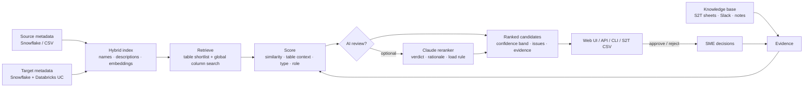

# Schema Compass

Find the right **source table and column** for every field of a **target data product** during a migration, with a confidence score, an explanation, and the evidence behind it.

Give it a target table (Snowflake or Databricks), or a table and a column. Schema Compass searches the source organization's metadata semantically, pulls in tribal knowledge from prior source-to-target (S2T) sheets, Slack threads and notes, and recommends the best match. You can also ask Claude to review the shortlist. Analysts approve or reject suggestions, and each decision improves later matches.



## Quick start

Requires Python 3.11 or later.

```bash
python -m venv .venv && source .venv/bin/activate
pip install -r requirements.txt
python -m schema_compass.cli serve
```

Open http://127.0.0.1:8000. On first run, a **Retail migration demo** project is created. To use your own data, select **New**, upload two metadata files and optionally some reference documents. No configuration files or code changes are needed.

### How a user works with it

1. **Project setup.** Upload the source and target metadata as CSV or Excel exports. Header names are flexible: `table_name`, `column_name`, `description`, `data_type`, and catalog/schema columns are all recognized. You get a data-quality report with tips, for example "only 40% of columns have a description". Then add any S2T sheets, Slack exports or notes.
2. **Find a source.** Start typing a target table, optionally pick a column, and select **Find source**. The answer is a decision card:
   - **Use this source**, **Likely source, confirm before using**, **Possible source, needs research**, or **No reliable source found**
   - a 0–100 confidence score
   - **Why**, in plain language
   - **Check before using**: width, conversion, time zone and look-alike warnings
   - warnings from your documents
   - **How we found this**: each step the engine took
3. **Decide.** Approve, reject, or mark as needs research. Behind an SSO proxy or Databricks Apps, the reviewer is taken from the signed-in user. Approved mappings rank first in later searches and can be exported as an S2T sheet from **Decisions**.
4. **Bulk mapping.** Map every column of a target table, or upload a list of `target_table, target_column` rows. Either way you get a downloadable spreadsheet with the recommendation, confidence, reasons, checks and alternatives for each field.

The bundled demo is a fictional retail acquisition. **OrgTRGT** ("lumen", with Databricks and Snowflake products) is migrating ten years of history from **OrgSRC**, a Snowflake warehouse with terse names such as `ORD_HDR.TOT_AMT` and `CUST_MSTR.CRT_DT`. Try these:

| Search | What it shows |
| --- | --- |
| `orders` | `ORD_HDR` wins. The look-alike `ORD_HDR_LGCY` is demoted because a Slack thread calls it deprecated. |
| `orders` / `customer_id` | `ORD_HDR.CUST_ID`, not `CUST_MSTR.CUST_ID`. The parent table's context breaks the tie between identical column names. |
| `CUSTOMER_PROFILE` / `SIGNUP_DATE` | `CRT_DT`. The name barely matches, but a prior S2T sheet maps it. |
| `product_catalog` / `product_name` | `ITEM_DESC` is the match, not `SKU_ID` (an identifier, not a name) and not `ITEM_LONG_DESC` (Slack says it holds marketing copy). |
| `CUSTOMER_PROFILE` / `MARKETING_OPT_IN` | Flags the `VARCHAR(1)` to `BOOLEAN` conversion and shows the S2T `CASE` rule. |
| `customer_reviews` | **No reliable source found**. The knowledge base says this source never existed. |

## What goes into a score

| Signal | What it captures |
| --- | --- |
| Name similarity | Physical and logical names after abbreviation expansion (`CUST_NM` becomes customer name), plural folding and business synonyms. Uses character and word TF-IDF. |
| Description similarity | Word n-gram TF-IDF over names plus descriptions |
| Semantic similarity *(optional)* | Sentence-transformer embeddings, cached on disk |
| Table context | A column inherits the strength of its parent table's match. A table match blends name similarity with **column coverage**: how well the target's columns are covered by the source table's columns. |
| Datatype compatibility | Same family, castable (with a note such as "decimal to integer may truncate"), or conflicting (capped) |
| Field role | Identifier vs name vs amount vs date vs flag, so `product_name` does not map to `SKU_ID` |
| Width | Flags a source `VARCHAR` wider than the target's |
| Evidence (RAG) | S2T rows (strong), Slack and notes passages that endorse or warn against a candidate, and "no source exists" statements |
| SME feedback | Approved pairs are pinned near 100. Rejected pairs are suppressed. |
| Claude review *(optional)* | Claude reads the shortlist and retrieved passages. It returns a verdict, confidence, rationale and load rule for each candidate, and is blended at 60% with the heuristic score. |

Confidence bands: **high** (80 and up, with a clear lead) means quick SME confirmation. **Medium** (60 to 79) means standard review. **Low** (40 to 59) means research before use. **None** (under 40) means likely a new, derived or out-of-scope field.

## Use your own metadata

Both organizations provide one row per column, using this contract. Table-level fields repeat on each row.

`PLATFORM, TABLE_PHYSICAL_NAME, TABLE_LOGICAL_NAME, TABLE_DESCRIPTION, COLUMN_PHYSICAL_NAME, COLUMN_LOGICAL_NAME, COLUMN_DESCRIPTION, COLUMN_DATATYPE, COLUMN_LENGTH`

In the web app, upload the files in **Project setup**. For the CLI, point [`schema-compass.toml`](schema-compass.toml) at CSV files, a Snowflake export table, or Unity Catalog directly:

```toml
[source]
type = "snowflake"
connection = "my_named_connection"     # from ~/.snowflake/connections.toml
table = "MIGRATION.META.SOURCE_COLUMNS"

[target]
type = "databricks"
profile = "my-profile"                 # Databricks CLI profile
catalogs = ["lumen"]
warehouse_id = "abc123"
```

Install the connector extras with `pip install -r requirements-connectors.txt`. To snapshot Unity Catalog metadata to the CSV contract:

```bash
python -m schema_compass.cli harvest-databricks --profile my-profile --catalog lumen target.csv
```

Logical names usually live in a data dictionary or governance tags rather than in `information_schema`. Fill them in when you have them, because they are among the strongest signals.

## Knowledge base (RAG)

Upload documents in **Project setup** (or list folders under `[knowledge] paths` for CLI use):

- **S2T sheets** (`.csv` / `.xlsx`). Columns named like `target_table, target_column, source_table, source_column, transformation, notes`; common aliases are accepted.
- **Slack exports** (`.json`). A channel export, either a message list or `{"channel", "messages"}`. Messages are grouped by thread.
- **Notes** (`.md` / `.txt`). Chunked by heading.

Evidence works per pair. A passage counts for a candidate only if it names both the target and the source field, and phrases such as "deprecated", "not X" or "don't use" turn it into a warning. Approved decisions can be exported with `export-approved` as an S2T sheet for the next wave.

## Optional components

```bash
# Dense embeddings
pip install -r requirements-semantic.txt
python -m schema_compass.cli --embedding-model sentence-transformers/all-MiniLM-L6-v2 serve

# Claude review: set ANTHROPIC_API_KEY (or run `ant auth login`), then tick "AI review" in the UI
python -m schema_compass.cli match product_catalog product_name --rerank
```

The AI review sends only the target field, the top candidates' metadata and the retrieved snippets. It uses `claude-opus-5-5` by default; change the model and effort in `[llm]`. Server-side refusal fallback is enabled. If the API is unavailable, results fall back to the heuristic ranking.

## CLI

```bash
python -m schema_compass.cli match orders                     # table-level
python -m schema_compass.cli match orders order_total_amount  # column-level
python -m schema_compass.cli map shipments --output s2t_shipments.csv
python -m schema_compass.cli evaluate                         # vs demo/gold_mappings.csv
python -m schema_compass.cli evaluate --no-knowledge          # ablation without RAG
python -m schema_compass.cli export-approved approved_s2t.csv
```

## Measuring quality

`evaluate` reports top-1 accuracy, recall@k, and abstention accuracy (whether no-source targets are correctly left unmatched) at both the table and column level. On the 82 hand-labeled demo pairs:

| | Table top-1 | Column top-1 | Column recall@3 | Abstention (column) |
| --- | ---: | ---: | ---: | ---: |
| Metadata only | 9/9 | 66/66 | 66/66 | 5/6 |
| Metadata + knowledge base | 9/9 | 66/66 | 66/66 | 6/6 |

Weights and thresholds were tuned on this small synthetic fixture, so treat these numbers as a regression floor, not a benchmark. Before relying on bands for a real program, label 50 to 100 pairs from your own domain, including look-alike negatives and fields with no source. Then run `evaluate --gold your_labels.csv` and adjust `Weights` in [`engine.py`](schema_compass/engine.py).

## Scaling notes

Source tables and columns are vectorized once at startup. A table query scores every source table but deep-scores (column coverage plus evidence) only a shortlist of 15. A column query scores every source column, then reranks the union of the top tables' columns, the global top 25, and anything an S2T sheet names. This handles tens of thousands of columns in a single process. Beyond that, move the dense vectors to Databricks Vector Search or Snowflake Cortex Search and keep this scoring layer as the reranker.

## Deploy

| Option | How |
| --- | --- |
| Docker | `docker build -t schema-compass .` then `docker run -p 8000:8000 -v compass-data:/data -e ANTHROPIC_API_KEY=... schema-compass`. Projects persist in the `/data` volume. |
| Databricks Apps | [`app.yaml`](app.yaml) runs the server on the app port. Databricks handles sign-in, and the user's email is recorded on every decision. Point `--home` at a persistent location (for example, a mounted volume) if projects must survive restarts. |
| Any VM | `python -m schema_compass.cli serve --host 0.0.0.0 --home /srv/compass` behind your SSO proxy. The proxy should forward `X-Forwarded-Email`. |

Environment variables: `SCHEMA_COMPASS_HOME` (project storage), `ANTHROPIC_API_KEY` (AI review), `SCHEMA_COMPASS_MODEL` / `SCHEMA_COMPASS_EFFORT` (Claude model and effort), `SCHEMA_COMPASS_EMBEDDINGS` (sentence-transformer model). The server has no built-in login. Run it on localhost or behind an identity-aware proxy.

## API

All matching endpoints are scoped to a project: `/api/projects/{id}/...`

| Method | Path | Purpose |
| --- | --- | --- |
| `GET` / `POST` | `/api/projects` | List or create projects |
| `POST` | `/api/projects/{id}/metadata/{source\|target}` | Upload a metadata file (CSV/XLSX) and get a quality report |
| `GET` / `POST` / `DELETE` | `/api/projects/{id}/knowledge` | Search, add or remove reference documents |
| `GET` | `/api/projects/{id}/suggest?q=&table=` | Typeahead for target tables and columns |
| `POST` | `/api/projects/{id}/match` | `{table, column?, k, rerank}` returns the decision, advice, trace, candidates and evidence |
| `POST` | `/api/projects/{id}/map-table` | Draft a mapping for every column of a table (also `GET .../map-table.csv`) |
| `POST` | `/api/projects/{id}/bulk` | Upload a list of target fields; returns rows and a CSV export link |
| `POST` / `GET` | `/api/projects/{id}/feedback` | Record or list decisions (also `GET .../approved.csv`) |
| `GET` | `/healthz`, `/api/config` | Health check; AI and embedding status and the signed-in user |

All organizations, products, people and conversations in `demo/` are fictional.
